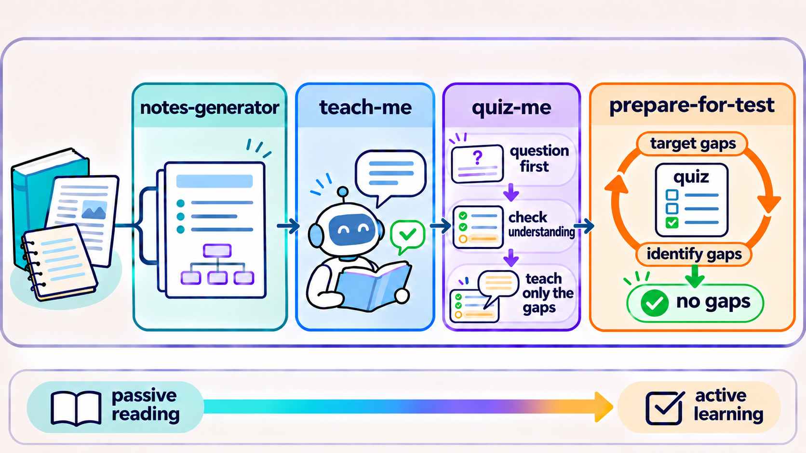

# Study Companion Skills

**Stop just reading. Start understanding.**

Turn textbooks, articles, course materials, and technical documents into reviewed study notes—then learn and prepare for tests with an adaptive AI tutor that teaches, quizzes, targets knowledge gaps, and remembers your progress.

## From passive reading to active learning

Reading something isn't the same as understanding it. And a summary alone can't tell you what you can actually explain, remember, or apply.

**Study Companion Skills combines four main workflows to bridge that gap:**



- **`notes-generator` — Turn your sources into clear, useful study notes.** Creates well-structured, source-backed notes that cover the big picture, key takeaways, important questions and answers, and helpful learning aids.
- **`teach-me` — Learn step by step with a tutor that adapts to you.** Breaks down concepts into manageable steps, checks your understanding, spots knowledge gaps, and adjusts its teaching based on your answers.
- **`quiz-me` — Find out what you know and what you don't.** Tests your understanding through targeted questions, identifies what you're struggling with, and explains the areas that need more work.
- **`prepare-for-test` — Get test-ready by focusing on what you don't know yet.** Quizzes you on all the test material, then focuses each new round on what you got wrong until you've mastered everything.

**What makes it different?**

- **Active learning, not passive rereading.** Test your ability to recall, explain, compare, diagnose, and apply what you've learned.
- **Teaching that adapts to you.** Get simpler explanations, alternative approaches, and targeted follow-up questions when you're struggling.
- **Progress that carries across sessions.** Your concept coverage, assessments, and next question are saved so you can pick up exactly where you left off.
- **Reusable transcripts.** When a teaching or quiz session pauses or ends, you can choose to save the session transcript to create questions or study notes later.

**The goal isn't just better notes. It's knowing what you truly understand—and what you still need to learn.**

## Fast and easy setup

Ready to turn your next reading into an interactive learning experience?

**Choose your AI coding assistant, copy the prompt, and let it handle the installation.**

### Claude Code

Paste this into Claude Code:

```text
Install Study Companion Skills from the GitHub repository weifengsiew/study-companion-skills as a user plugin, so it is available in all my projects. Add its marketplace if needed, then confirm that the plugin is enabled. Explain the available study workflows, what each one is for, and how I can start using them.
```

### Codex

Paste this into Codex:

```text
Install Study Companion Skills as a plugin from the GitHub repository weifengsiew/study-companion-skills. Add its marketplace if needed, install and enable the plugin, then tell me to start a new chat. Explain the available study workflows, what each one is for, and how I can start using them.
```

### Start learning

Provide accessible source material, then choose a workflow:

- Use `notes-generator` to create study notes.
- Use `teach-me` for guided learning.
- Use `quiz-me` to test your understanding.
- Use `prepare-for-test` to cover the tested material and focus subsequent quizzes on identified gaps.

You can use existing notes with the learning workflows. If you do not provide notes, the source material can be used instead. Your progress is saved, so you can pause and resume later.

## Requirements

- Codex or Claude Code with plugin support.
- Source material supplied by the learner.
- Notes supplied by the learner or generated through a separate `notes-generator` request. If the learner declines to provide notes, the source is used as the notes.

## Codex setup and management

### Install

Add this repository as a plugin marketplace from your terminal:

```bash
codex plugin marketplace add weifengsiew/study-companion-skills
```

Start Codex and open the plugin browser:

```bash
codex
```

Then run `/plugins`, find **Study Companion Skills**, and select **Install plugin**. Start a new chat before using it for the first time.

### Update in Codex

Refresh the marketplace from your terminal:

```bash
codex plugin marketplace upgrade study-companion-skills
```

Open `/plugins` in Codex to confirm the installed version, then start a new chat.

### Uninstall

Remove the plugin from your terminal:

```bash
codex plugin remove study-companion-skills@study-companion-skills
```

## Claude Code setup and management

### Install

In Claude Code, ask:

```text
Install Study Companion Skills from the GitHub repository weifengsiew/study-companion-skills as a user plugin, so it is available in all my projects. Add its marketplace if needed, then confirm that the plugin is enabled.
```

Or install it from your terminal:

```bash
claude plugin marketplace add weifengsiew/study-companion-skills
claude plugin install study-companion-skills@study-companion-skills --scope user
```

### Load for one session

To try the plugin for one session without installing it:

```bash
git clone https://github.com/weifengsiew/study-companion-skills.git
claude --plugin-dir ./study-companion-skills
```

If Claude Code is already open, run `/reload-plugins` to load the plugin. Otherwise, it loads the next time you start Claude Code.

### Update in Claude Code

Third-party marketplaces have automatic updates turned off by default. To update the plugin from your terminal, run:

```bash
claude plugin update study-companion-skills@study-companion-skills
```

### Uninstall

Remove the user-scoped plugin from your terminal:

```bash
claude plugin uninstall study-companion-skills@study-companion-skills --scope user
```

## Usage

### Codex

Generate notes:

```text
Use $notes-generator to turn <source-path> into learning notes.
```

Start a guided study session:

```text
Use $teach-me with source <source-path> and notes <notes-path>.
```

Start a question-first quiz session:

```text
Use $quiz-me with source <source-path> and notes <notes-path>.
```

Prepare for a test:

```text
Use $prepare-for-test to set up and run preparation from my tested topics, sources, and notes.
```

### Claude Code

Skills installed through the plugin are namespaced with `study-companion-skills`:

```text
/study-companion-skills:notes-generator Turn <source-path> into learning notes.
```

```text
/study-companion-skills:teach-me Use source <source-path> and notes <notes-path>.
```

```text
/study-companion-skills:quiz-me Use source <source-path> and notes <notes-path>.
```

```text
/study-companion-skills:prepare-for-test Set up and run preparation from my tested topics, sources, and notes.
```

Use `teach-me`, `quiz-me`, `notes-generator`, or `prepare-for-test` as the normal entry points. Internal workflows, including `test-prep-setup`, remain available for delegation and explicit advanced use; their descriptions identify them as internal to discourage accidental routing.

## Included skills

### Public workflows

- `teach-me` sets up a persistent study session from source material and learner-provided notes, or uses the source as the notes when needed.
- `quiz-me` sets up a persistent question-first assessment session and explains identified gaps.
- `notes-generator` creates reviewed learning notes from source material, subsection by subsection.
- `prepare-for-test` first quizzes all tested material, then creates follow-up quizzes focused only on recorded gaps until none remain.

### Internal workflows

- `teach-loop`
- `quiz-loop`
- `gaps-extractor`
- `test-prep-setup` interviews the learner about tested and excluded topics, creates or validates `test-topics.md`, verifies source and notes paths, and initializes persistent quiz progress for `prepare-for-test`.
- `study-session-manager`
- `learning-preference-manager`
- `question-generator`
- `answer-generator`
- `scope-reviewer`
- `learning-aid-creator`
- `big-picture-generator`
- `practical-takeaway-generator`
- `notes-formatter`
- `duplication-reviewer`
- `alignment-reviewer`
- `transferability-reviewer`

The plugin installs every workflow together. On OpenAI surfaces, only the four public workflows are selected automatically. In Claude Code, narrow internal descriptions guide ordinary requests through the public workflows while preserving delegated and explicit use.

## Repository structure

```text
study-companion-skills/
├── .agents/
│   └── plugins/
│       └── marketplace.json
├── .claude-plugin/
│   ├── marketplace.json
│   └── plugin.json
├── plugin.json
└── skills/
    ├── teach-me/
    ├── quiz-me/
    ├── notes-generator/
    ├── test-prep-setup/
    ├── prepare-for-test/
    └── supporting skills...
```

Each skill contains a required `SKILL.md` and optional UI metadata in `agents/openai.yaml`. On OpenAI surfaces, internal workflows set `allow_implicit_invocation: false`; Claude Code uses their narrowly scoped descriptions for routing. The root `plugin.json` is the portable package manifest; `.claude-plugin/plugin.json` is the Claude Code compatibility manifest.

## Development

Validate a skill with the validator bundled with Codex's `skill-creator`:

```bash
python /path/to/skill-creator/scripts/quick_validate.py skills/teach-me
```

Validate the Claude Code plugin and marketplace when Claude Code is installed:

```bash
claude plugin validate .
```

Test direct, indirect, incomplete, negative, and edge-case prompts before publishing changes.

## License

Licensed under the [MIT License](LICENSE). Copyright © 2026 Siew Wei Feng.
